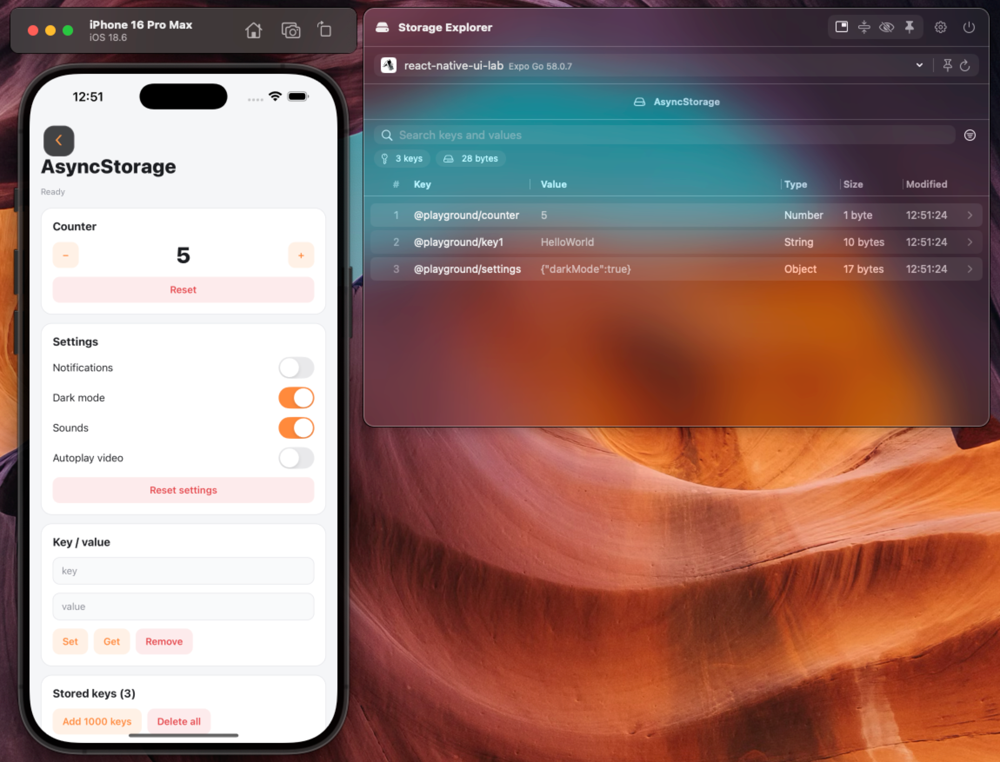

<div align="center">


# Storage Explorer

**Inspect React Native app storage in real time, right next to iOS Simulator.**<br>
No packages to install. No changes to your app code.

[](https://github.com/Emin91/StorageExplorer/releases/latest)


[](LICENSE)

[Install](#installation) · [Features](#features) · [How it works](#how-it-works) · [Roadmap](#roadmap)

</div>

<p align="center">
  
</p>

https://github.com/user-attachments/assets/f18fe01e-0353-4caf-b9aa-1643b4d0cf97

## Installation

```bash
curl -fsSL https://raw.githubusercontent.com/Emin91/StorageExplorer/main/install.sh | bash
```

That's it. The script downloads the latest release, installs **Storage Explorer** into **Applications** and launches it, without the "developer cannot be verified" warning. Run it again any time to update.

<details>
<summary><b>Prefer a manual download?</b></summary>

1. Download `StorageExplorer-<version>.dmg` from [Releases](https://github.com/Emin91/StorageExplorer/releases/latest) and open it.
2. Drag **Storage Explorer** into the **Applications** folder.
3. Launch the app. macOS will say the developer cannot be verified: the app is not yet notarized by Apple.
4. Go to **System Settings → Privacy & Security** and click **Open Anyway** at the bottom. You only need to do this once.

</details>

**First launch:** grant **Accessibility** permission when prompted, so the panel can follow the Simulator window. Then click the orange tab at the edge of the Simulator to open the panel.

## Features

### 🔌 Plugins

| Plugin            | What you see                                              | Setup                                         |
| ----------------- | --------------------------------------------------------- | --------------------------------------------- |
| **AsyncStorage**  | All keys of regular builds and Expo Go projects           | None                                          |
| **MMKV**          | Every `react-native-mmkv` instance, labeled with its name | None                                          |
| **Redux Persist** | `persist:*` entries unpacked into state slices            | None                                          |
| **Redux**         | Live store state, updated on every change                 | [One line in your app](docs/plugins/redux.md) |

Coming soon: Zustand, MobX, Realm, Encrypted Storage.

### ⚡ Real-time data

- Key, value, type, size and last-modified columns. Resize them, hide the ones you don't need.
- Updates the moment your app writes data.
- Changed values flash briefly: in the key list, in the JSON tree and on the plugin cards.
- Search across keys and values with highlighted matches.
- Sort by any column and filter by value type.
- Key count and total storage size at a glance.

### 📊 Statistics

- A bar chart comparing all enabled plugins: storage size, key count and total.
- Updates live as your app writes data.
- Click a bar to jump straight to that plugin's keys.

### 🔍 Value inspector

- Collapsible JSON tree with syntax highlighting.
- Search inside a value, step through the matches one by one.
- JSON nested in strings is decoded automatically.
- Raw mode with pretty-printed JSON.
- One-click copy for keys and values.

### 📱 App selection

- Every app with storage data on all booted simulators: icon, name, version, bundle ID, device and iOS version.
- Follows the app you're running. Pin it to keep the current selection.
- Open the app's data folder in Finder with one click.

### ⚙️ Settings

- Turn plugins on and off.
- Metro port for the Redux plugin.
- Change highlight: on/off, color and duration.
- Panel spacing, background material and opacity.
- Launch at login.
- Menu bar only mode, without a Dock icon.
- Reset everything to defaults, including column widths.

## Requirements

- macOS 15 or later
- Xcode with iOS Simulator
- A React Native app running in the Simulator

## How it works

Storage plugins read data directly from your app's files in the Simulator (`~/Library/Developer/CoreSimulator/Devices/…`), so nothing needs to be installed in your React Native project. Redux lives in memory, so it's read from the running app instead.

| Storage       | How it's read                                                                                 |
| ------------- | --------------------------------------------------------------------------------------------- |
| AsyncStorage  | `manifest.json` plus separate files for large values; changes tracked with file system events |
| MMKV          | The binary instance format; re-read every second                                              |
| Redux Persist | `persist:*` entries from AsyncStorage and MMKV, with the double JSON encoding unpacked        |
| Redux         | Live store state through Metro and the Hermes debugger ([details](docs/plugins/redux.md))     |

## Limitations

- Read-only: data can't be edited yet.
- iOS Simulator only: physical devices and Android are not supported.
- Encrypted MMKV instances can't be read.
- Redux Persist shows the persisted state; use the Redux plugin for the live state.
- Redux needs a debug build with Metro running.
- Last-modified times are tracked only while Storage Explorer is running.

## Roadmap

- [ ] Editing, adding and deleting keys
- [ ] Zustand, MobX, Realm, Encrypted Storage and SQLite plugins
- [ ] Dispatching Redux actions and an action log
- [ ] JSON export and import
- [ ] Keyboard shortcuts

## Project structure

```
App/          entry point, AppDelegate, menu bar icon
Windows/      floating panel and its windows
Services/     app discovery, AsyncStorage/MMKV/Redux Persist readers, Redux bridge, Simulator tracking
ViewModels/   app selection, plugin data, statistics, panel state
Views/        SwiftUI interface: table, value inspector, statistics, settings
Models/       data models
Extensions/   helper extensions
scripts/      DMG build
install.sh    one-command installer
```

## Author

**Emin Zeynalov**

[](https://t.me/emin91zeynalov)
[](https://github.com/Emin91)
[](https://www.linkedin.com/in/emin91zeynalov/)

## License

Storage Explorer is free and open source under the [Apache License 2.0](LICENSE).

You're welcome to use, modify and share it, including in commercial projects. If you distribute it or a modified version, keep the [NOTICE](NOTICE) file with the original attribution and mark the files you changed.

Copyright © 2026 Emin Zeynalov
